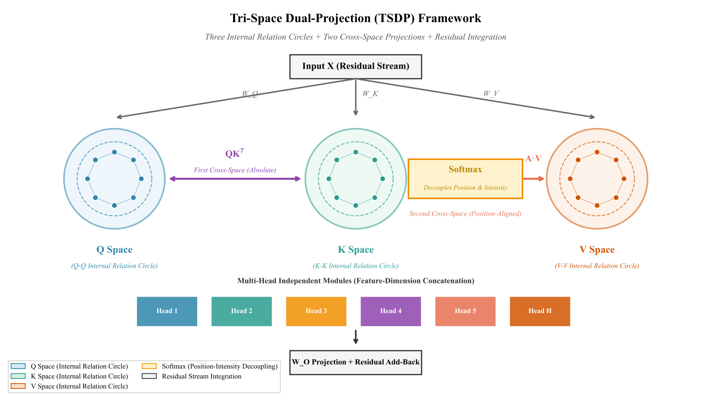

# Paper II: Tri-Space Dual-Projection (TSDP) Framework

This folder contains the source code, raw data, and core figures for the paper **"Tri-Space Dual-Projection: Unifying Attention and Multi-Head Mechanisms."**

## 📌 Overview
We propose the TSDP framework, explicitly mapping Transformer mechanisms to a geometric view:
*   **Q-K Projection**: Defines the boundary of identity and difference (tong-yi).
*   **Softmax**: Allocates value shares and decouples position from intensity.
*   **A-V Projection**: Position-aligned weighting.
*   **Residual Streams**: Global linear evolution.

## 🖼️ Core Visualizations

*Figure 1: TSDP Framework.*

*Figure 2: Causal intervention results (Cutting QK causes collapse).*

## 📂 Directory Structure
*   `/code`: Python scripts for data collection, causal interventions, and plotting.
*   `/data`: Raw CSV data for all models (GPT-2, BERT, Qwen, MoE).
*   `/figures`: High-resolution visualizations (T-series, G-series, Experiments).

Please refer to the `README.md` in each subfolder for detailed instructions.
