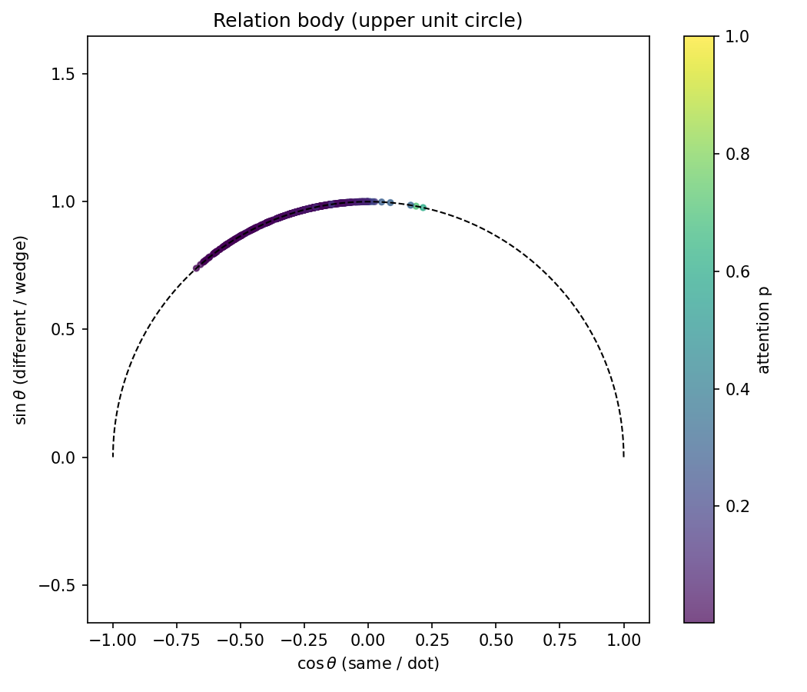
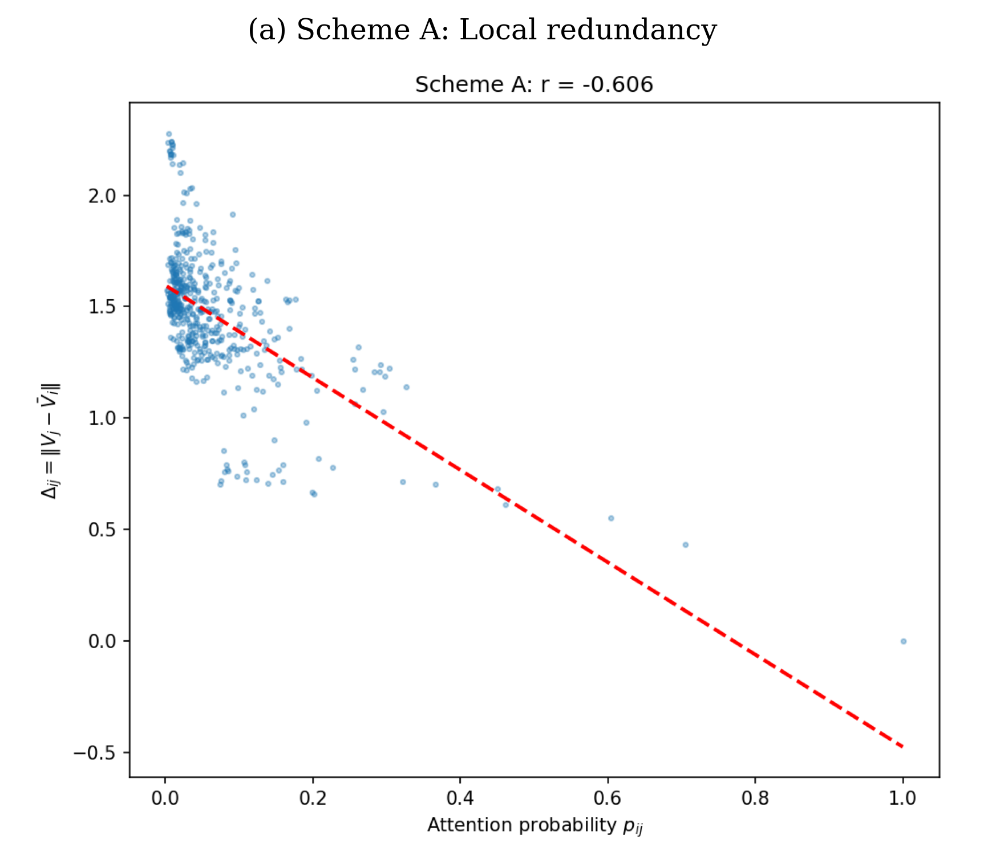

# Paper I: Foundational Theorems of Relation Body Geometry

This folder contains the supplementary materials and source code for the foundational paper:
**"Relation Body Geometry: A Geometric Theory of Attention"** (Currently under review at TMLR).

## 📌 Overview
This paper establishes the foundational theorems (Theorem 1-4) of Relation Body Geometry, revealing the intrinsic geometric relationship between attention probabilities and semantic redundancy in Transformers. It also reports the macro-level Tree/Bush structures observed in dense models.

## 🖼️ Core Visualizations

*Figure 1: The foundational Relation Body Unit Circle ($c^2 + s^2 = 1$).*

*Figure 2: The empirical verification of the 100% negative correlation between attention probability and local redundancy (Theorem 2).*

## 📂 Contents
- `Paper_I_Anonymous.pdf`: The anonymized full paper submitted to TMLR.
- `code/`: Python scripts for reproducing the foundational experiments (PC1 calculation, U-shape analysis).
- `data/`: Raw CSV data for the initial experiments.
- `figures/`: High-resolution PNG visualizations.

## ⚠️ Note on Anonymity
To comply with the double-blind review policy of TMLR, all files in this folder are kept anonymous.